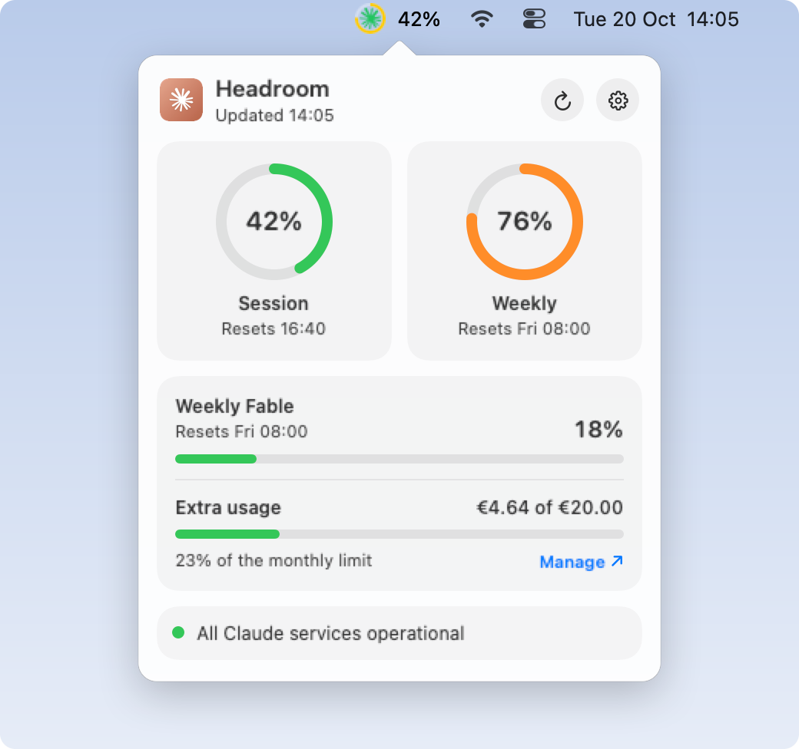
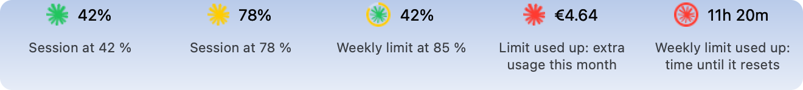

# Headroom

Your Claude usage in the macOS menu bar: how much of the 5-hour session and the weekly limits you have used, extra usage, and Claude's service status, with alerts before you run out.

**[Download the latest release](https://github.com/videlov/headroom/releases/latest)** · macOS 13 or later · [MIT license](LICENSE)

<picture>
  <source media="(prefers-color-scheme: dark)" srcset="screenshots/popup-dark.png">
  
</picture>

## Features

<picture>
  <source media="(prefers-color-scheme: dark)" srcset="screenshots/menu-bar-dark.png">
  
</picture>

- **Menu bar icon** with your session usage in percent. The Claude symbol turns yellow at 70 % and red at 90 % of your session limit. From 70 % of a weekly limit, a ring around the symbol shows how full the fullest one is, yellow and then red from 90 %. Gray means the numbers aren't current; `!` means claude.ai no longer accepts your session cookie.
- **When a limit is used up**, the menu bar says what happens now: `€4.64`, this month's extra usage, while extra usage covers you; otherwise the time until the limit resets, such as `11h 20m`, with a full red ring when it's the weekly limit. Hover over the icon to see every limit in words.
- **Usage at a glance:** the 5-hour session and the weekly limit as rings with their reset times, the Sonnet and Fable limits when your plan has them, extra usage spend, free credits and limit resets. Numbers that aren't current turn gray.
- **Alerts** when the session passes 25, 50, 75 and 90 %, when the weekly limit passes 90 % and when it's used up, when extra usage starts being charged, and when a Claude service you track has an incident. If macOS has Headroom's notifications turned off, Settings says so and opens System Settings for you.
- **Refresh interval** from 1 to 60 minutes (default 1), and a refresh after the Mac wakes up. The refresh button in the popup fetches right away.
- **⌘U** opens the popup from anywhere. Settings and the session cookie have pages of their own in it: **Open at Login**, System, Dark or Light appearance, the services to track, and **Quit**.
- **Liquid Glass** buttons on macOS 26 and later.
- **Menu bar only:** no Dock icon.

## Install

1. Download `Headroom.dmg` from the [latest release](https://github.com/videlov/headroom/releases/latest).
2. Open it and drag **Headroom** to **Applications**.
3. Start Headroom. Releases are signed with a self-signed certificate and not notarized by Apple, so macOS blocks the first launch: open **System Settings → Privacy & Security** and click **Open Anyway**.

macOS asks once whether Headroom may send notifications. Every 3 hours Headroom checks this repository for a new version and shows a banner when one is out.

## Connect your Claude account

Headroom reads your usage with your claude.ai session cookie.

1. Open [claude.ai/settings/usage](https://claude.ai/settings/usage) in your browser.
2. In the browser's developer tools, find the **usage** REST API request.
3. Copy the value of its **Cookie** request header.
4. Click the Headroom icon, then the gear and **Session Cookie** (on the first start, **Add Session Cookie**), paste the value and click **Save**.

When the session ends, for example because you logged out of claude.ai, the menu bar shows `!` and the popup asks for a fresh session cookie; copy one the same way. Headroom stops polling claude.ai until you do.

## Privacy

The session cookie is kept in your login keychain and nowhere else: Headroom keeps no cookie store or HTTP cache on disk, and deletes the ones earlier versions left in `~/Library/HTTPStorages` and `~/Library/Caches`. The popup doesn't show the saved cookie, only the last characters of its sessionKey. The settings are in Headroom's preferences. Headroom connects only to:

- `claude.ai`, for the same usage data the claude.ai usage page loads;
- `status.claude.com`, for service incidents;
- `raw.githubusercontent.com`, for this repository's [`latest.json`](latest.json), the update feed.

Headroom is not affiliated with Anthropic. It relies on claude.ai's internal API, which can change and break it at any time.

## Build from source

You need Xcode or the Xcode Command Line Tools.

```bash
scripts/make-signing-cert.sh   # once per Mac
scripts/test.sh                # run the self-tests
scripts/build.sh               # build/Headroom.app
scripts/install.sh             # copy it to /Applications and start it
scripts/package.sh             # build/Headroom.dmg
scripts/screenshots.sh         # redraw the screenshots in this README
scripts/preview.sh             # render every page of the popup into build/preview
```

`make-signing-cert.sh` creates a self-signed code-signing certificate, `videlov Code Signing`, in your login keychain, and `build.sh` signs with it. With a stable certificate, macOS treats every build as the same app, so Headroom keeps reading the cookie from the Keychain without asking. To use your own name, run `scripts/make-signing-cert.sh "My Code Signing"` and build with `SIGNING_IDENTITY="My Code Signing" scripts/build.sh`; `SIGNING_IDENTITY=-` signs ad hoc.

The code is in [`Sources`](Sources): `UsageStore` and `ClaudeAPI` fetch the usage, `StatusStore` the service status and `UpdateStore` the update feed; `UsageView` and its pages draw the popup, and `MenuBarController` the menu bar item. The self-tests that `scripts/test.sh` runs are in [`Tests`](Tests). `scripts/screenshots.sh` draws the screenshots with [`screenshots/main.swift`](screenshots/main.swift), from the same views filled with sample data; its renderer can't draw Liquid Glass, so they show the buttons as before macOS 26. `scripts/preview.sh` renders every page of the popup with [`screenshots/preview.swift`](screenshots/preview.swift), through the window server, so the glass shows.

## Release a new version

1. Raise `CFBundleShortVersionString` and `CFBundleVersion` in `Resources/Info.plist`, and `version`, `title` and `description` in `latest.json`. The update banner shows that title and description.
2. Build and package, then commit and push to `main`.
3. Publish the DMG under its usual name, which the update banner downloads:

   ```bash
   gh release create vX.Y.Z build/Headroom.dmg --title "Headroom X.Y.Z"
   ```

## License

MIT, see [LICENSE](LICENSE). The Claude symbol in the menu bar and the app icon comes from [Simple Icons](https://simpleicons.org) (CC0) and is a trademark of Anthropic.
